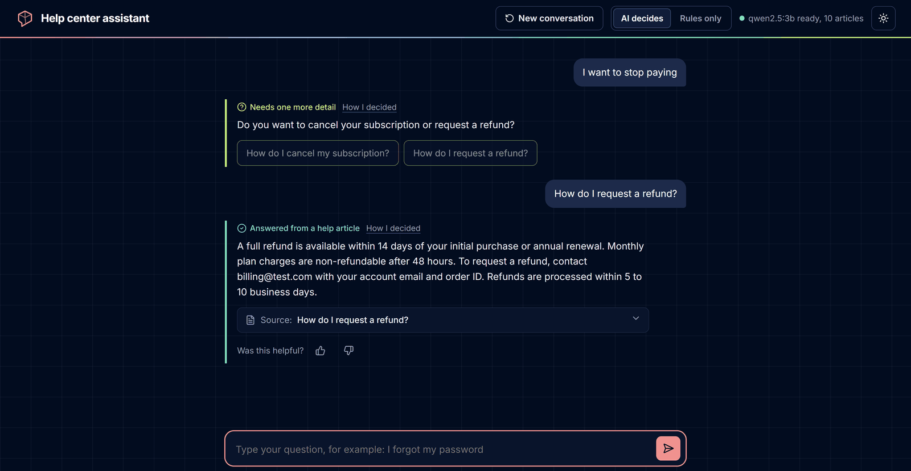
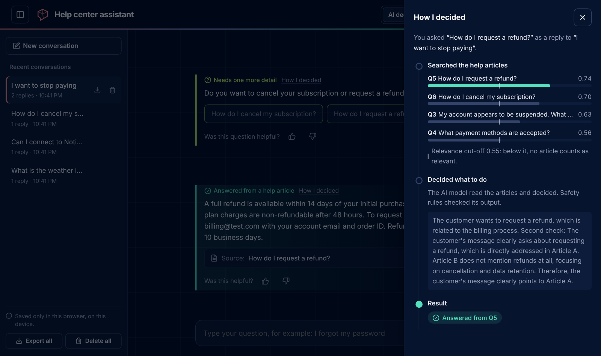
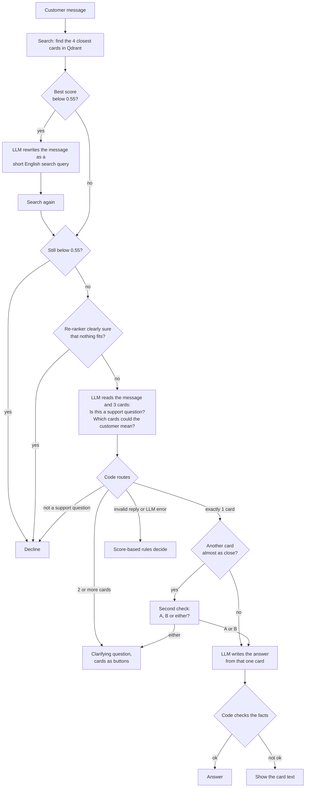

# Agentic Customer Support Assistant

[](https://github.com/EinaasKharsah/agentic-support-assistant/actions/workflows/tests.yml)

A support assistant that answers customer questions from a small knowledge base (10 Q&A cards).
For every message it decides what to do:

| Decision | When | Example |
|---|---|---|
| **Answer** | One card clearly fits | "I forgot my password" → answer from the password card |
| **Ask a clarifying question** | Several cards could fit | "I want to stop paying" → "Do you want to cancel your subscription or request a refund?" |
| **Decline** | Not a support question | "What is the weather in Berlin?" → polite decline |

Everything runs locally: a small LLM in Ollama (`qwen2.5:3b`), embeddings with `bge-small-en-v1.5`, a multilingual re-ranker (`bge-reranker-v2-m3`), and Qdrant as the vector store.

**Results** (details in [Evaluation](#evaluation)):

- **90%** correct decisions on 20 new questions, written after development and committed before the run (85% when run again after the last changes).
- 102 of 119 (86%) on the five question sets used during development.
- **No invented numbers, e-mail addresses, menu paths or product names reached the customer.** Code checks every written answer against its article; if the check fails, the article itself is shown. The check cannot judge reasoning: 2 of the 41 answers the model wrote in the last run drew a wrong conclusion (see [Limitations](#limitations-and-next-steps)).

---

## Demo

**Vague question → clarifying question → answer.** After the customer picks "refund", the assistant answers from the refund article, including the 48-hour condition.



**"How I decided" panel** (opens only on request): scores, the model's reason, and who decided.



More examples: [PayPal is not mentioned](docs/images/not-mentioned.png), [weather question declined](docs/images/decline.png).

---

## Quick start

```bash
docker compose up --build
```

Open http://localhost:8000. The first run downloads the models (about 2.7 GB), so it takes a few minutes. Until the LLM is ready, the agent uses its score-only rules.

- **NVIDIA GPU:** `docker compose -f docker-compose.yml -f docker-compose.gpu.yml up --build`
- **Ollama already on your computer** (recommended on a Mac): set `OLLAMA_URL=http://host.docker.internal:11434` in `.env` (see `.env.example`) and run `docker compose up --build app`.

**Without Docker:**

```bash
pip install -r requirements.txt
ollama pull qwen2.5:3b
uvicorn app.main:app --reload     # Qdrant runs in memory when QDRANT_URL is not set
```

**Tests:** `pip install -r requirements-dev.txt && pytest`. The 113 tests need no Ollama and no internet (fake LLM, embedder and re-ranker). GitHub Actions runs them, checks the Compose files and builds the Docker image on every push.

---

## How it works



1. **Search.** The message is embedded with `bge-small-en-v1.5` and compared with the 10 cards (cosine similarity).
2. **Retry weak searches.** If no card scores 0.55, the LLM checks that the message has a meaning and rewrites it as an English search query (typos, other languages).
3. **Guardrails.** Nothing above 0.55 → decline without the LLM. A re-ranker then reads the message with each card and declines only when it is clearly sure that nothing fits.
4. **The LLM understands, the code routes.** The LLM answers two simple questions in JSON: *is this a support question?* and *which cards could the customer mean?* Code turns this into decline, answer or clarify.
5. **Second check.** If another card is almost as close, the LLM chooses "A, B or either"; "either" becomes a clarifying question.
6. **Grounded answer, checked by code.** The LLM writes the reply from the chosen card only. Code checks it against the card; if it fails, the card text is shown.
7. **Follow-up.** After a clarifying question, the page sends the earlier message too, so "refund" after "I want to stop paying" is understood.

Every reply includes the reason, who decided (LLM, guardrail or rules) and the scores, shown in the "How I decided" panel.

---

## Design decisions and trade-offs

### 1. LLM: `qwen2.5:3b` in Ollama

I compared three sizes on the same prompt. The key test was *"Can I pay with PayPal?"*, which the knowledge base does not answer.

| Model | Answer |
|---|---|
| qwen2.5:0.5b | "Yes, PayPal is accepted" (invented) |
| qwen2.5:1.5b | "Yes, you can pay with PayPal" (invented) |
| qwen2.5:3b | "PayPal is not mentioned in our help article" + the accepted methods |

3b is the smallest model that did not invent answers, and it fits in 4 GB of GPU memory. Larger models would be more reliable but slower and too big for my GPU. Temperature 0 and a fixed seed; small GPU differences can still change a close decision, so results vary by about one question between runs. Details: [`docs/model_comparison.md`](docs/model_comparison.md).

### 2. Embeddings: `bge-small-en-v1.5` with fastembed

Small (130 MB), fast on a CPU, and runs with ONNX (no PyTorch). Each card is one vector (category + question + answer); the cards are short, so chunking would only lose context. The query instruction recommended for BGE is added to queries, not to cards. Trade-off: English-only, which is why weak searches are rewritten into English.

### 3. Vector store: Qdrant

| Option | Good | Bad |
|---|---|---|
| NumPy / FAISS | Simplest / very fast | Vectors only: storage and filtering by hand |
| Chroma | Easy to start | Less control in server mode |
| pgvector | Good if Postgres already exists | A database for a 10-card demo |
| **Qdrant (chosen)** | Stores vectors **with** the card data; the same code runs in memory (tests) and as a server (Docker); filters | One more service |

Indexing is idempotent: each card gets a fixed ID (`uuid5`), so restarts update cards instead of adding copies.

**At larger scale:**

| Topic | What changes |
|---|---|
| Long articles | Split into chunks of 200 to 400 words, keep the article ID in the payload |
| Memory | 1 million `bge-small` vectors ≈ 1.5 GB; Qdrant can keep them on disk and compress them (about 4x less memory) |
| Precision | Filter by product, language or plan **before** the search; add keyword search (BM25) for error codes and names (hybrid search); let the re-ranker order more candidates |
| Operations | Server mode with persistent storage, sharding and replication; index in a separate job; choose the thresholds again on a larger evaluation set |

If the articles already live in PostgreSQL, pgvector would avoid a second database.

### 4. Re-ranker: `bge-reranker-v2-m3` (multilingual)

A re-ranker reads the message and an article **together**, so it can tell "reset my password" from "reset my iPhone passcode" better than vector search. It only scores the 4 cards found. Compared on 119 development questions without the LLM ([`scripts/calibrate_reranker.py`](scripts/calibrate_reranker.py)):

| | Vector search | `ms-marco-MiniLM-L-6-v2` | **`bge-reranker-v2-m3-int8`** |
|---|---|---|---|
| Right card first (78 answerable) | 63 | 69 | **75** |
| Other languages | weak | English-only | works |

It is used only where it is reliable:

- **Decline** when the out-of-scope example beats every article by at least 1 point, or when no article scores above -10.5. Smaller differences are noise at these low scores (even a capital letter could flip them), so the LLM decides instead. Text is lower-cased, so "notion" and "Notion" get the same decision.
- **Answer instead of asking** when the LLM would ask "A or B?" but exactly one card scores at least +3 (an article's own title scores about +6). Every correct clarifying question in the tests had its best card below +2.
- **The LLM still sees the cards in vector order.** The re-ranker's order made it list only the first card more often (clarifying questions 7/7 → 5/7).
- Cost: about 3 seconds more per question on the CPU (about 9 seconds in total).

### 5. Agent design: "the LLM understands, the code routes"

The most important decision, and it came from evaluation. When the LLM chose the action directly, accuracy was **80%**, below a simple score baseline (83%): the 3b model often wrote a correct reason and then chose the wrong label. When it answered simpler questions (*support question? which cards?*) and code mapped them to an action, accuracy rose to **88%** and clarifying questions from 2/7 to 5/7.

The LLM still does all the understanding: scope, which cards fit, whether two cards are both possible, how to rewrite a failed search. The code enforces what should never depend on a model: the card must exist, the out-of-scope example (Q10) is never an answer, internal names are never shown, and an LLM error never leaves the customer without a reply. **The LLM decides what the message means; the code decides what the system is allowed to do.**

Other choices:

- **Structured output** with a JSON schema enforced by Ollama; the `reason` field comes first, so the model reasons before it chooses.
- **Q10 is never shown to the LLM.** It is generic, so it appeared among the matches for many normal questions, and the model then declined them.
- **Second check instead of a longer prompt.** Small models rarely notice ambiguity alone, but choose well between two options.
- **Answer rules:** say when the article does not mention something instead of yes or no; correct false statements; say it cannot act on the account; ignore instructions that try to change the article.
- **Answer fact check:** numbers, e-mail addresses, menu paths and product names in the answer must be in the article, and the article's numbers (time limits) must be in the answer. A name the article does not contain (PayPal, Notion) may only appear in a sentence that says it is not mentioned.
- **No LangChain:** plain Python, every step visible and testable. **Stateless API:** the page sends the previous message after a clarifying question.

Changes that were tried and not kept are listed in the [evaluation log](docs/evaluation_log.md#tried-and-not-used).

### 6. The system keeps working when a part fails

| What fails | What happens |
|---|---|
| The LLM returns invalid JSON or an unknown card | The score-based rules decide |
| Ollama is down or the model is missing | Retried once, then the rules decide and answers use the card text; `/health` and the page show it |
| The re-ranker fails | The vector scores are used |
| Qdrant is still starting | The app waits and retries |
| The written answer fails the fact check | The card text is shown, and the reason says why |

### 7. Chat page

Plain HTML, CSS and JavaScript, served by FastAPI. Suggested questions, card buttons for clarifying questions, the source card behind each answer, 👍/👎 on every reply, the "How I decided" panel, a switch to compare "AI decides" with "Rules only", and light and dark themes. Earlier conversations are listed in a side bar and can be exported as JSON or deleted; they are stored only in the browser. Accessible (WCAG AA contrast, keyboard use, screen-reader labels), and server text is always inserted as text, never as HTML.

### 8. Feedback loop

Every 👍/👎 is saved to `feedback/feedback.jsonl` with **the decision behind the reply** (action, cards, who decided, reason, scores, model). A 👎 on a decline marks a wrong decision, not only a wrong answer.

`python scripts/export_feedback.py` turns it into a review queue (👎 cases, in the evaluation format, so real questions become test questions) and fine-tuning examples (👍 decisions with the exact decision prompt). `GET /feedback/stats` shows 👍/👎 per decision type. This follows the idea of the clinician accept/reject step in ACIE: real judgments first measure quality, and later improve the model.

Trade-offs: feedback is optional and biased toward unhappy users; a 👍 is not a verified label; and the file contains customer messages, so it stays out of git and needs retention and access rules (GDPR).

---

## Evaluation

```bash
python evaluation/run_eval.py --set main --with-answers                  # also: robustness, hard, fixes_dev
python evaluation/run_eval.py --file evaluation/heldout_v3.csv --with-answers
python evaluation/run_eval.py --mode rules                               # score-only baseline
```

| Set | Size | What it tests | Result |
|---|---|---|---|
| [**New questions**](evaluation/heldout_v3.csv) | 20 | Written after development, committed before the run | **18/20 (90%)**; 17/20 when run again after the last changes |
| [Main](evaluation/eval_set.json) | 41 | 25 to answer, 7 vague, 9 out of scope, in my own words | 41/41, clarifying questions 7/7 |
| [Robustness](evaluation/robustness_set.json) | 20 | Typos, one word, other languages, prompt injection, random text | 17/20 |
| [Precise answers](evaluation/heldout_v2.csv) | 20 | Exact conditions, false assumptions, requests it cannot do, manipulation | 17/20 |
| [Hard](evaluation/hard_set.json) | 20 | Reasoning, negation, near-misses, small talk | 14/20 |
| [Fix development](evaluation/fixes_dev_set.json) | 18 | Other companies, other tools, other languages | 13/18 |

All errors on the new questions are safe: a decline or a clarifying question instead of an answer. Measured: decision accuracy, errors grouped by harm (`unsafe`, `wrong_card`, `missed_clarify`, `over_clarify`, `over_decline`), Recall@1 and @3, and with `--with-answers` every written answer, which I read.

### How the system improved

Each step changed one thing, and was kept only if it did not lower the earlier sets.

| Step | Main set | Clarify | Other sets |
|---|---|---|---|
| Baseline: similarity scores decide | 83% | 2/7 | - |
| The LLM chooses the action | 80% | 2/7 | - |
| Q10 hidden from the LLM | 78% | 1/7 | - |
| The LLM describes, the code routes | 88% | 5/7 | - |
| Second check + 4 cards retrieved | 90% | 6/7 | Robustness 70% |
| Rewrite weak searches | 98% | 7/7 | Robustness 85% |
| Rewrite prompt without topic words; "has meaning" check | 98% | 7/7 | Robustness 90% |
| Answer fact check | 98 to 100% | 7/7 | - |
| Re-ranker, answer rules | 100% | 7/7 | Development sets 99 → 103 of 119 |
| Re-ranker only when sure; names in the fact check | 100% | 7/7 | Development sets 102 of 119 |

Full log, including what did not work: [`docs/evaluation_log.md`](docs/evaluation_log.md). Every question, decision, reason and answer: [`evaluation/results/`](evaluation/results).

**Limits:** the sets are small (20 to 41 questions) and written by me, and the development sets were used to choose changes, so their numbers are optimistic. Real questions from the feedback loop would be a fairer test.

---

## API

Interactive docs: http://localhost:8000/docs

| Method | Path | Purpose |
|---|---|---|
| `POST` | `/chat` | Send a message, get the decision and reply |
| `POST` | `/feedback` | Save 👍/👎 with the decision behind the reply |
| `GET` | `/feedback/stats` | 👍/👎 per decision type |
| `GET` | `/health` | Cards loaded, LLM status, model, re-ranker |

```bash
curl -X POST http://localhost:8000/chat -H "Content-Type: application/json" \
  -d '{"message": "refund", "previous_message": "I want to stop paying"}'
```

All settings (model, thresholds, re-ranker) are environment variables, listed with their meaning in [`.env.example`](.env.example).

---

## Project structure

```
app/
  agent.py               The decision logic: answer, clarify or decline
  answering.py           Writes the answer from one card and checks its facts
  vector_store.py        Qdrant storage and search
  embeddings.py          Text to vectors (bge-small via fastembed)
  reranker.py            Scores each card together with the message
  llm.py                 Small Ollama client (retries, JSON output, health)
  main.py                REST API (FastAPI)
  config.py              Settings from environment variables
  knowledge_base.py      Loads and validates the cards
  static/                Chat page
data/knowledge_base.json The 10 cards
docs/                    Model comparison, re-ranker calibration, evaluation log, screenshots
evaluation/              Question sets, metrics, runner and saved results
scripts/                 Try search and answers, calibrate the re-ranker, export feedback
tests/                   Unit and API tests (no Ollama or internet needed)
Dockerfile, docker-compose.yml, docker-compose.gpu.yml, .github/workflows/tests.yml
```

---

## Limitations and next steps

- **Questions about other companies' products** ("change the email on my Facebook account", "What is Netflix's refund policy?") share words with our articles and are answered from them. The answer then shows our article, but does not say it is not about Facebook. Separating them needs a larger LLM or a small classifier.
- **Arabic and some short non-English messages** are sometimes declined. A multilingual embedding model (`bge-m3`) would remove the need for the rewrite.
- **The fact check does not understand reasoning.** Two written answers drew a wrong conclusion from correct facts: "I bought the plan last week" got "it has been more than 14 days, so you are not eligible", and "Can I switch my login email?" got "not through the settings, contact support" (the article describes how to change it). A second LLM call that compares the reply with the article, or a larger model, would be the next step. When the check does fail, the full article is shown, which is correct but not always a direct answer.
- **Manipulative messages** are not always corrected: no false claim was accepted, but sometimes a clarifying question was asked instead of stating the real condition.
- **Speed:** about 9 seconds per question on a 4 GB laptop GPU. **Memory:** only one earlier turn.

Next steps: use the feedback loop to collect real test questions and, later, fine-tune the decision step; try a larger LLM for the decisions; check answers for meaning with a second LLM call (the main risk left); hand over to a human when the customer is frustrated; stream answers.

---

## Use of AI tools

An AI coding assistant (Claude) supported the implementation, mainly in writing and debugging code, and also in writing test questions.

All design and engineering decisions were my own, including the system architecture, the selection of the LLM, embedding model, and vector store, the agent design and its guardrails, and the design of the test sets and error metrics. Each change to the agent was based on evaluation results that I ran locally and reviewed before deciding on the next step. 
